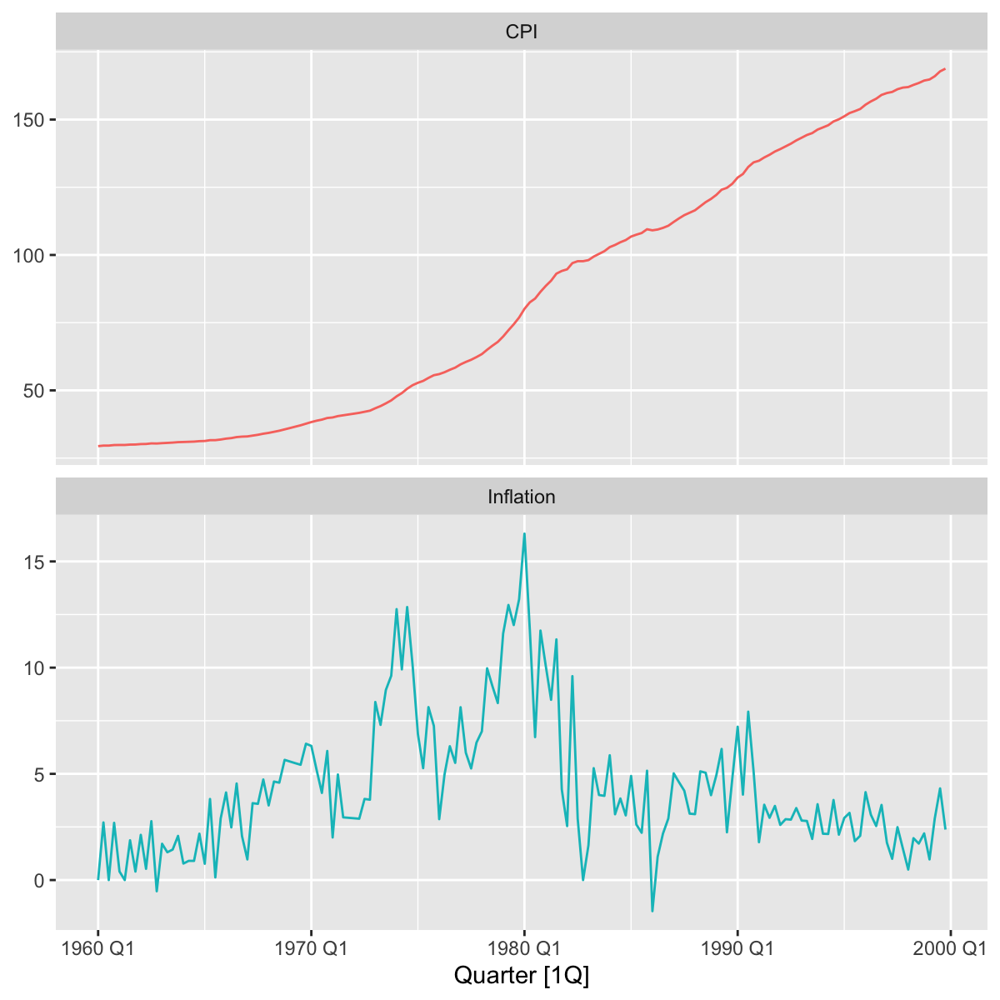
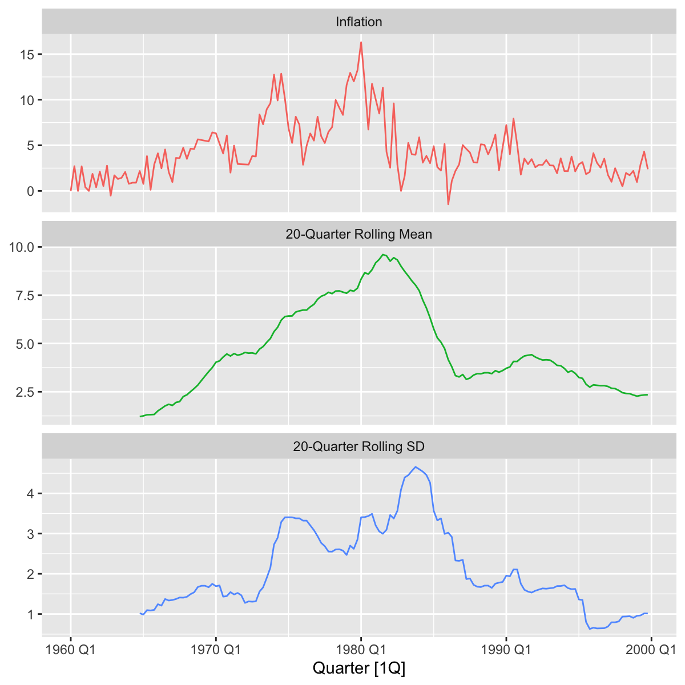
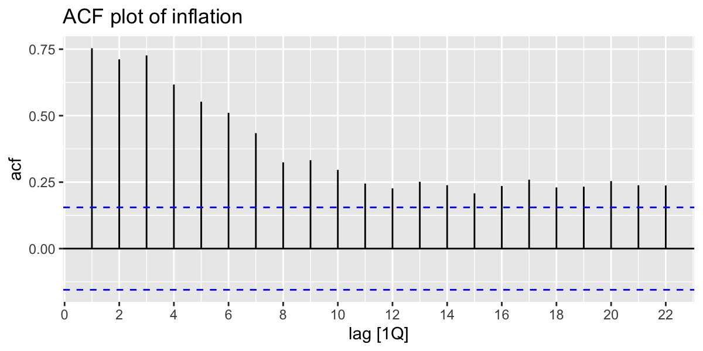
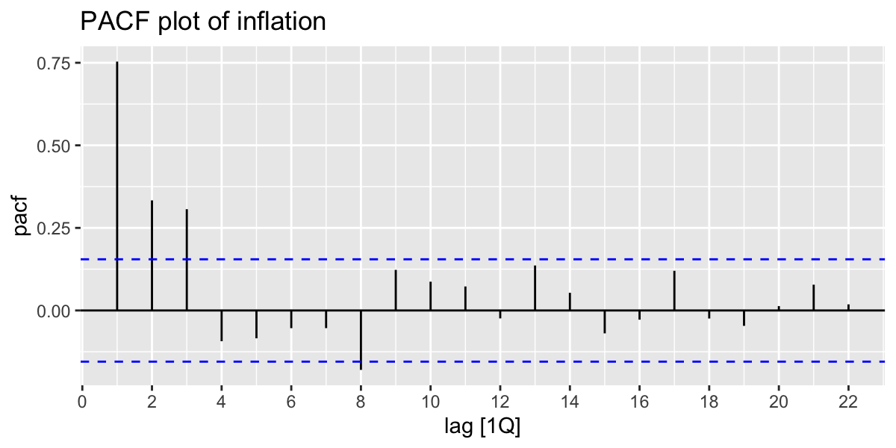
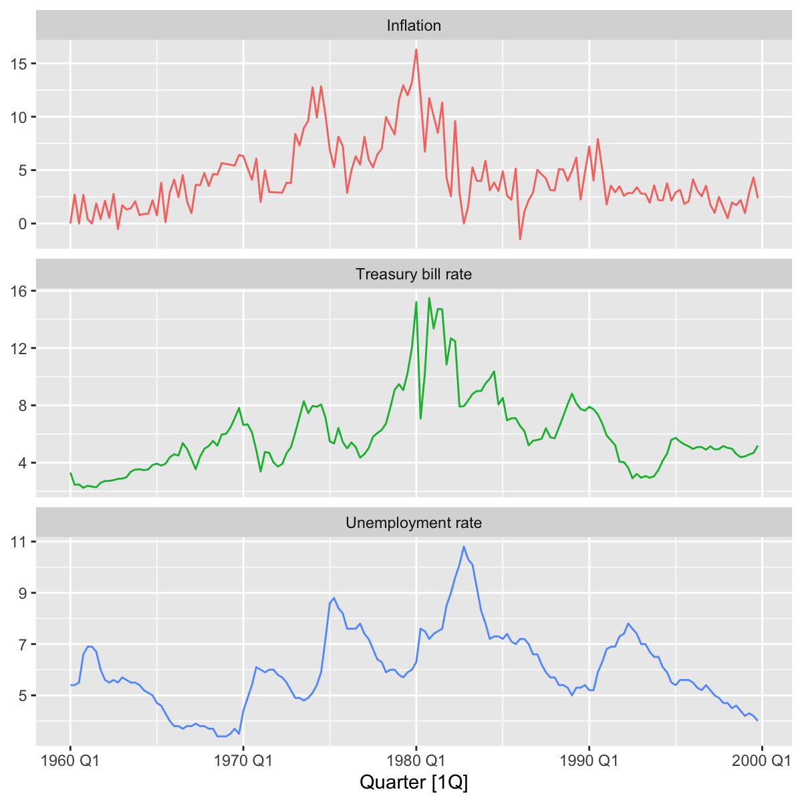
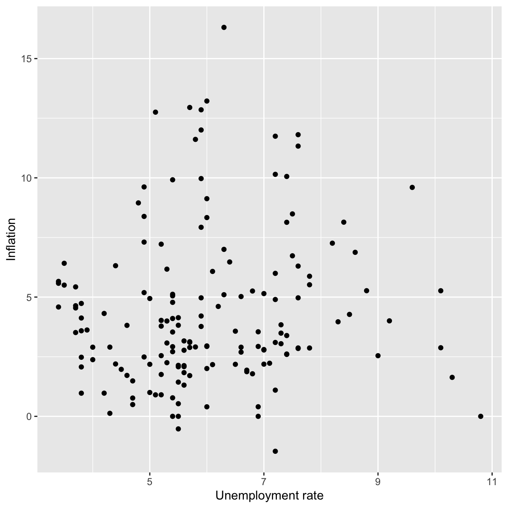

# Data

Our analysis includes three datasets from the Federal Reserve Economic Data (FRED):

1. *Consumer Price Index for All Urban Consumers: All Items in U.S. City Average* (CPIAUCSL),

2. *Unemployment Rate* (UNRATE), and

3. *3-Month Treasury Bill Secondary Market Rate, Discount Basis* (TB3MS).

See @tbl-datasets in the Appendix for more details.

# Exploratory Data Analysis

The three FRED datasets include data from as early as 1934 through as late as 2026. For an initial analysis, we will use the period 1960Q1-1999Q4.

## Data Quality

We begin by evaluating the data quality. First, we load the datasets and convert them to tsibbles.

```r
library(readr)
library(tsibble)
library(dplyr)

# Load data
CPIAUCSL <- read_csv("datasets/CPIAUCSL.csv") |>
  mutate(observation_date = yearmonth(observation_date)) |>
  as_tsibble(index = observation_date)
  
TB3MS <- read_csv("datasets/TB3MS.csv") |>
  mutate(observation_date = yearmonth(observation_date)) |>
  as_tsibble(index = observation_date)

UNRATE <- read_csv("datasets/UNRATE.csv") |>
  mutate(observation_date = yearmonth(observation_date)) |>
  as_tsibble(index = observation_date)
```

We verify the data does not contain any anomalies by counting the rows in each dataset and checking that they have neither missing nor duplicate entries.

```r
# Verify data quality
for (dataset in list(CPIAUCSL, TB3MS, UNRATE)) {
  print(nrow(dataset))
  if (has_gaps(dataset) | is_duplicated(dataset)) {
    print("Abnormality detected!")
  }
}
```

We get the following row counts:

| Dataset | Rows |
|--|-|
| CPIAUCSL | 956 |
| TB3MS | 1112 |
| UNRATE | 944 |

There were no abnormalities detected; all of the data is usable.

## Constructing inflation

We will calculate inflation using the Consumer Price Index (CPI) values from CPIAUCSL.

For this purpose, we will convert the monthly data into quarterly data by retaining the March, June, September, and December values. We will keep all data from 1959Q4 (needed to calculate the inflation in 1960Q1) through 1999Q4.

```r
library(lubridate)

CPI.Q <- CPIAUCSL |>
  filter(month(observation_date) %in% c(3, 6, 9, 12)) |>
  mutate(Quarter = yearquarter(observation_date)) |>
  as_tsibble(index = Quarter) |>
  filter_index("1959 Q4" ~ "1999 Q4")
```

With the quarterly CPI values, we next construct annualized quarter-over-quarter inflation as

$$
\pi_t = 400\log\left( \frac{P_t}{P_{t-1}} \right).
$$

```r
inflation <- CPI.Q |>
  mutate(Inflation = 400 * log(CPIAUCSL / lag(CPIAUCSL))) |>
  filter_index("1960 Q1" ~ .) |> 
  rename(CPI = CPIAUCSL)
```

## CPI and inflation

We compare the CPI and inflation numbers between 1960Q1 and 1999Q4.

```r
library(feasts)
library(tidyr)

inflation |>
  pivot_longer(cols = c(CPI, Inflation),
               names_to = "series",
               values_to = "value") |>
  as_tsibble(index = Quarter, key = series) |>
  autoplot(value) +
  facet_wrap(~ series, ncol = 1, scales = "free_y") +
  labs(y = NULL) +
  theme(legend.position = "none")
```



While the inflation numbers fluctuated up and down between 1960 and 1999, the CPI level rose almost constantly. This is because inflation was almost always positive during this period. Inflation describes the rate of change of the CPI—even if inflation decreases, as long as it remains positive, CPI will continue to rise.

Next, we plot inflation against a trailing 20-quarter mean and standard deviation.

```r
library(slider)

inflation <- inflation |>
  mutate(
    roll.mean = slide_dbl(Inflation, mean, .before = 19, .complete = TRUE),
    roll.sd = slide_dbl(Inflation, sd, .before = 19, .complete = TRUE)
  )

inflation |>
  pivot_longer(cols = c(Inflation, roll.mean, roll.sd),
               names_to = "series",
               values_to = "value") |>
  as_tsibble(index = Quarter, key = series) |>
  autoplot(value) +
  facet_wrap(~ series, ncol = 1, scales = "free_y",
             labeller = as_labeller(c(
               "Inflation" = "Inflation",
               "roll.mean" = "20-Quarter Rolling Mean",
               "roll.sd" = "20-Quarter Rolling SD"
             ))) +
  labs(y = NULL) +
  theme(legend.position = "none")
```



The rolling values show us that both mean and standard deviation inflation were variable between 1960Q1-1999Q4, even after we smooth away noise. It also appears that standard deviation is a function of the level of the series.

Next, we plot the ACF and PACF of inflation.

```r
inflation |> ACF(Inflation) |> autoplot() +
  labs(title = "ACF plot of inflation")

inflation |> PACF(Inflation) |> autoplot() +
  labs(title = "PACF plot of inflation")
```





Autocorrelation decays slowly and remains significant even after many lags, while PACF shows significant spikes only through the first three lags. The direct dependence being concentrated in the first three lags suggests that an appropriate time series model for inflation might include an AR(3) component.

Now, we plot two potential predictors of inflation: unemployment and the Treasury bill rate.

```r
UNRATE.Q <- UNRATE |>
  filter(month(observation_date) %in% c(3, 6, 9, 12)) |>
  mutate(Quarter = yearquarter(observation_date)) |>
  as_tsibble(index = Quarter) |>
  filter_index("1960 Q1" ~ "1999 Q4")

TB3MS.Q <- TB3MS |>
  filter(month(observation_date) %in% c(3, 6, 9, 12)) |>
  mutate(Quarter = yearquarter(observation_date)) |>
  as_tsibble(index = Quarter) |>
  filter_index("1960 Q1" ~ "1999 Q4")

inflation$Unemployment <- UNRATE.Q$UNRATE
inflation$Treasury <- TB3MS.Q$TB3MS

inflation |>
  pivot_longer(cols = c(Inflation, Unemployment, Treasury),
               names_to = "series",
               values_to = "value") |>
  as_tsibble(index = Quarter, key = series) |>
  autoplot(value) +
  facet_wrap(~ series, ncol = 1, scales = "free_y",
             labeller = as_labeller(c(
               "Inflation" = "Inflation",
               "Unemployment" = "Unemployment rate",
               "Treasury"   = "Treasury bill rate"
             ))) +
  labs(y = NULL) +
  theme(legend.position = "none")
```



The Treasury bill rate does seem related to inflation, as they roughly trend together. Like inflation, the Treasury bill rate changed level drastically many times during 1960Q1-1999Q4. Unemployment seems less strongly correlated with inflation. To investigate this further, we plot inflation against employment.

```r
library(ggplot2)

inflation |>
  ggplot(aes(x = Unemployment, y = Inflation)) +
  geom_point() +
  labs(x = "Unemployment rate", y = "Inflation")

cor(inflation$Inflation, inflation$Unemployment)
```



There does not appear to be a strong correlation between inflation and unemployment; calculating the correlation coefficient verifies this.

```r
cor(inflation$Inflation, inflation$Unemployment)
```

There is an extremely weak correlation of $0.10$.

## Change-point analysis

To identify changes in level in the inflation series, we perform a PELT change-point analysis using a BIC penalty. We generate a table detailing the start, end, and mean inflation rate of each segment.

```r
library(changepoint)

cpt_result <- cpt.mean(inflation$Inflation, method = "PELT", penalty = "BIC")
cpt_locations <- cpts(cpt_result)
cpt_dates <- inflation$Quarter[cpt_locations]

segment_means <- param.est(cpt_result)$mean
seg_start <- c(1, cpt_locations + 1)[1:length(segment_means)]
seg_end <- c(cpt_locations, nrow(inflation))

segments_tbl <- tibble(
  Segment = seq_along(segment_means),
  Start = inflation$Quarter[seg_start],
  End = inflation$Quarter[seg_end],
  Mean = segment_means
)
```

| Segment | Start | End | Mean |
|-|-|-|-|
|  1  | 1960 Q1 | 1965 Q3 |  1.26 |
|  2  | 1965 Q4 | 1968 Q1 |  3.25 |
|  3  | 1968 Q2 | 1970 Q4 |  5.41 |
|  4  | 1971 Q1 | 1972 Q4 |  3.28 |
|  5  | 1973 Q1 | 1973 Q4 |  8.56 |
|  6  | 1974 Q1 | 1974 Q4 | 11.4  |
|  7  | 1975 Q1 | 1978 Q1 |  6.16 |
|  8  | 1978 Q2 | 1978 Q4 |  9.14 |
|  9  | 1979 Q1 | 1980 Q2 | 13.0  |
| 10  | 1980 Q3 | 1980 Q3 |  6.73 |
| 11  | 1980 Q4 | 1981 Q3 | 10.4  |
| 12  | 1981 Q4 | 1982 Q1 |  3.41 |
| 13  | 1982 Q2 | 1982 Q2 |  9.60 |
| 14  | 1982 Q3 | 1983 Q1 |  1.50 |
| 15  | 1983 Q2 | 1985 Q4 |  4.00 |
| 16  | 1986 Q1 | 1986 Q3 |  0.61 |
| 17  | 1986 Q4 | 1990 Q4 |  4.68 |
| 18  | 1991 Q1 | 1999 Q4 |  2.55 |

This is a large number of change points. This fits with what is observed in the 20-quarter rolling mean graph above; even after smoothing noise, the level of the series changes significantly many times. This means that one constant historical mean does not adequately describe the level during the full period.

# Appendix

## FRED datasets {.appendix}

| Series name | FRED code | Retrieval date | First observation | Last observation | Original frequency |
|----|-|-|-|-|-|
| Consumer Price Index for All Urban Consumers: All Items in U.S. City Average | CPIAUCSL | 2026-09-27 | 1947-01-01 | 2026-08-01 | Monthly |
| Unemployment Rate | UNRATE | 2026-09-27 | 1948-01-01 | 2026-08-01 | Monthly |
| 3-Month Treasury Bill Secondary Market Rate, Discount Basis | TB3MS | 2026-09-27 | 1934-01-01 | 2026-08-01 | Monthly |

: FRED datasets {#tbl-datasets}